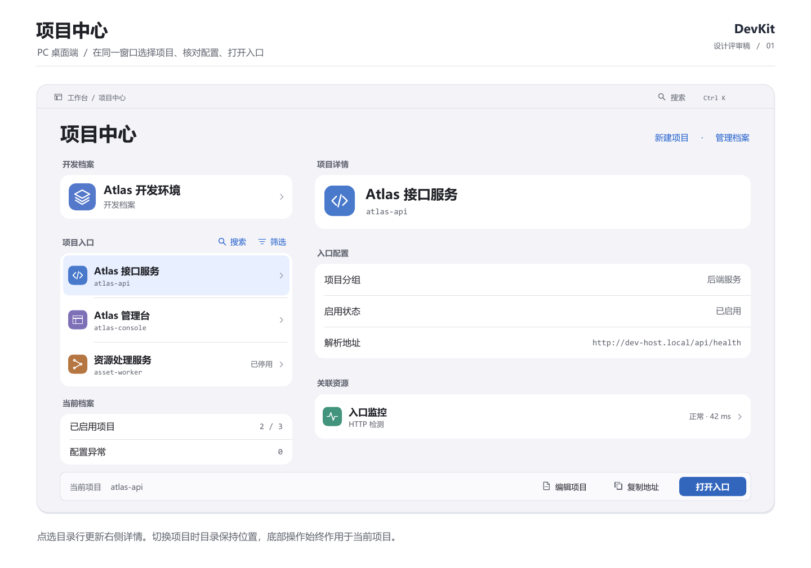

# DevKit 工作页重设计方案

2026 年 11 月 24 日 · 设计评审稿 · 对应 DevKit 2.7.0

**DevKit 是 PC 桌面工作台，工作台总览沿用当前版本。** 评审场景是在 Windows 或 Linux 电脑上查项目、处理文本、看监控。iOS「设置」提供分组列表、大字号和留白的视觉参考；桌面交互沿用鼠标、键盘、多任务页签和可调整窗口。画板聚焦进入栏目后的工作区，顶部只节选已有导航作定位。Atlas 项目、路径和采样值为本地示例。[四页静态设计稿](devkit-design.pdf)

## 先看操作路径

| 稿页 | 用户要做的事 | 页面如何响应 |
| --- | --- | --- |
| 01 · 项目中心 | 在开发档案找到 Atlas 接口服务，核对解析地址并打开 | 左栏选项目，右栏看配置及关联监控。底栏左端再次标明作用对象，右端提供编辑、复制地址和打开入口。 |
| 02 · JSON 格式化 | 整理一段健康检查响应，对照原文与结果 | 处理选项位于编辑器上方；原文和结果并排，多任务页签可见。底栏放载入示例、复制结果和运行，运行键提示 Ctrl + Enter。 |
| 03 · 监控中心 | 判断响应变慢的时间，核对记录并返回来源项目 | 左侧固定检测对象，右侧把曲线和最近记录放在一起。样本时间、HTTP 状态和毫秒数按列对齐。 |
| 04 · 项目目录状态 | 判断档案正在读取、为空或读取失败 | 三种状态占据同一列表位置。本机可编辑时，空档案提供新建项目；读取失败在原地重试。 |

## 为什么采用分组列表

PC 上核对十几个项目时，点进详情再逐级返回会打断比较。左栏只列名称、编码和停用等例外状态，右栏使用稳定的字段顺序，允许连续点选或用键盘换行核对。相邻操作跟随当前对象，搜索和筛选仍靠近项目目录。编辑器与监控页沿用这套层次，同时把更多横向空间留给代码和时间序列。

这与 Apple 在 iOS「设置」中用分组列表逐层揭示内容的做法一致。截至评审日，Apple 列出的正式版为 iOS 27.2.1 和 macOS 27.2.1。WWDC26 对复杂背景上的玻璃可读性和侧栏层次作了调整。本稿只在悬浮导航和操作栏使用轻材质，列表、地址、日志和代码使用实色。具体颜色和尺寸是 DevKit 的设计取值。[Apple 正式版本记录](https://support.apple.com/en-us/100100) · [列表与表格](https://developer.apple.com/design/human-interface-guidelines/lists-and-tables) · [材质](https://developer.apple.com/design/human-interface-guidelines/materials) · [WWDC26 设计更新](https://developer.apple.com/videos/play/wwdc2026/102/?id=503)

## 页面与状态约定

**项目列表与详情。** 单击项目行更新详情，不自动打开外部页面。目录聚焦时，上下方向键移动当前行；Tab 进入详情和底部动作。“复制地址”复制当前档案解析出的完整 URL，“打开入口”沿用既有打开方式。批量操作沿用勾选框和选择计数，与当前查看的项目分别表示。切换档案以档案和项目 ID 重新定位。停用、缺变量和解析失败显示具体原因，并按当前业务规则限制动作。共享访客的查看、编辑和操作权限继续由服务端决定。

**监控。** “已启用”描述项目配置，“正常”来自实际检测。采样区显示所选样本的时间和毫秒值，鼠标拖动吸附到最近的样本，左右方向键逐点移动。桌面记录表按时间倒序排列，错误采样保留原因。“来源项目”应定位到对应档案和项目。“立即检测”沿用现有的维护、禁用和操作权限判断。无样本时显示“等待首次检测”，暂停、过期、维护和故障分别显示文字。

**文本编辑。** 沿用每个任务已有的输入、参数、输出和执行状态。输入或参数变化后以现有状态标记结果是否过期。复制成功才显示“已复制”，剪贴板不可用时提供手动复制入口。解析错误在结果区给出原因，焦点可回到原文修改。保留现有全套模式、独立任务和快捷键；图中选取“格式化 / 压缩”示意分段外观。窄内容区使用“输入 / 结果”分段，切换时保留编辑器实例、光标和滚动位置。

**数据对应。** 项目行取当前档案中的项目名称、编码和启停状态，入口取已有地址解析结果。监控曲线和记录表共享同一个样本集合，横轴对应采样时间，纵轴对应耗时；表中 HTTP 结果取样本详情，TCP 场景改显示连接结果。编辑器的输入、模式、结果和文件元信息均绑定任务 ID。[项目中心](../../../src/ProjectCenter.tsx) · [监控数据模型](../../../src/monitor-api.ts) · [任务模型](../../../src/workbench.ts)

## 尺寸、材质与布局

| 项目 | 设计取值与行为 |
| --- | --- |
| 颜色 | 浅色背景 `#F3F3F8`，分组表面 `#FFFFFF`，正文 `#202127`，次要文字 `#61646F`，行动蓝 `#205ECC`。深色背景 `#222329`，分组 `#303137`，正文 `#F0F1F6`。这些值通过栏目根节点的语义变量映射到主题，用户已选择的风格和明暗设置继续生效。 |
| 字体 | 中文使用现有系统字体栈。桌面页标题 30–34 px，目录项目名 16–17 px，字段 15–16 px，组标题和说明 13–15 px。路径、行号、HTTP 状态与耗时采用本机等宽字体；编辑器遵循用户已保存的字号。 |
| 留白与密度 | 宽屏内容区左右 32–44 px，组间 24–36 px，组内左右 16–18 px。普通字段高 44–52 px，名称加编码的目录行高 56–76 px。紧凑偏好缩短行距，分组和键盘焦点仍清楚。长地址可换行并完整复制。 |
| 窗口缩放 | 以**应用侧栏、边距扣除后的内容宽度**判断。达到约 980 px 时项目目录与详情约占 1∶2；760–979 px 优先收紧目录和间距；更窄时由当前项目选择器唤出目录，保留选中对象。编辑器可并排时优先遵循已有分栏／堆叠偏好。 |
| 底部操作 | 约 50 px 高的水平操作栏吸附在栏目内，左端是当前对象或结果状态，右端是两至三个高频动作。首要按钮靠右。长表单、日志和长代码有各自滚动区，最后一行可滚到栏的上方。栏下方留出既有全局状态栏。[Apple 工具栏指南](https://developer.apple.com/design/human-interface-guidelines/toolbars) |
| 无障碍 | 常规 PC 点击目标建议至少 32 × 32 CSS px，可见图标 16–20 px。支持完整键盘操作、右键及复制习惯，悬停信息在键盘聚焦时也可读取。正文对比度目标 4.5∶1，必要边界和焦点目标 3∶1。200% 缩放时允许表单换行，宽表在自身容器滚动。[Apple 无障碍指南](https://developer.apple.com/design/human-interface-guidelines/accessibility) |

## 现有组件怎么用

| 复用点 | 本稿和后续实现的约定 |
| --- | --- |
| Floating Navbar | 现有顶栏负责跨栏目、全局搜索与工作区操作。任务页签保留位置和选中态，各页底栏承接当前对象动作。共享门户的 NavigationSheet 继续承担其窄屏导航。[桌面外壳](../../../src/App.tsx) · [共享门户](../../../src/SharedPortal.tsx) · [抽屉](../../../src/NavigationSheet.tsx) |
| Bento Grid、卡片反馈 | 宽屏项目目录与详情按信息量分宽，关联 API、服务、Nginx、监控复用现有资源网格。独立资源卡可按触点微倾、松手回正；设置式列表行用按压底色。总览继续使用现有布局和 Aurora 资源。[项目资源总览](../../../src/ProjectOverview.tsx) · [卡片动效](../../../src/tool-card-motion.ts) |
| Segmented、MotionButton | 模式选择沿用真实宽度的滑块、单一 Tab 入口和方向键。载入、复制和运行沿用按钮按压、忙碌和完成反馈；执行结果直接驱动标签。[分段选择](../../../src/SegmentedControl.tsx) · [动作组件](../../../src/Motion.tsx) |
| Marquee、CodeMirror | 导入的长文件名由 FileMeta 管理，编码始终可见；键盘聚焦可读全名，减少动态时换行。原文与结果沿用现有 CodeMirror 字号、选区、换行和只读语义。[文件名](../../../src/FileMeta.tsx) · [编辑器](../../../src/CodeEditor.tsx) · [文本工作区](../../../src/ToolWorkspace.tsx) |
| Skeleton、样本图 | 按原位置和最终行高显示骨架；异步读取结束后切换到内容、空态或错误。趋势沿用 Latency 与 RollingMilliseconds，吸附时读数与游标一致。性能模式和减少动态时直接到达最终状态；减少透明度或高对比度时提供实色栏。[骨架](../../../src/Skeleton.tsx) · [监控中心](../../../src/MonitorCenter.tsx) · [现有动效约定](../../ui-motion.md) |

## 后续实施顺序与验收

1. **先核对 PC 上的项目与监控链路。** 在 ProjectCenter、ProjectOverview、MonitorCenter 内接入分组和底栏。用 1440 × 900 常规窗口、1366 × 768 笔记本和调整至半屏的窗口核对。鼠标连续选中两个项目、用键盘切回第一个、进入关联监控并返回，检查目录位置、解析地址、当前对象和操作权限。读取、空档案、重试对照第 04 页。
2. **再接入一个真实文本任务。** 从现有总览粘贴 JSON 后进入格式化，检查原文和模式带入；载入文件、切换任务、运行、修改后重跑、复制结果、出错后修正各走一遍。覆盖长文件名、窄屏、明暗主题及性能模式。桌面操作沿用 Ctrl/Cmd + K 和 Ctrl/Cmd + Enter。
3. **按工作流扩展到其他栏目。** HTTP 调试把请求与响应作为主工作区，底栏随“发送 / 取消”更新；日志和终端把空间留给连续文本，来源与筛选进抽屉；服务、Nginx、Git 的配置字段可分组，启停、批量及确认流程继续使用各自权限和确认入口。先按页评审，再确定推广范围。
4. **以现有总览作独立回归基线。** 对照同尺寸、主题及会话数据下的总览首屏和工具库，核对布局、导航和滚动切屏。分别从 JSON 对象、13 位时间戳和“项目中心”进入对应工具或栏目。若未来新增功能影响识别，同时更新匹配清单与回归用例。[现有匹配清单](../../overview-matching.md)

本次交付用于评审静态画面、层级与操作位置。Electron 窗口中的键盘顺序、读屏、缩放、多任务状态及动态性能属于后续实现验收项。
