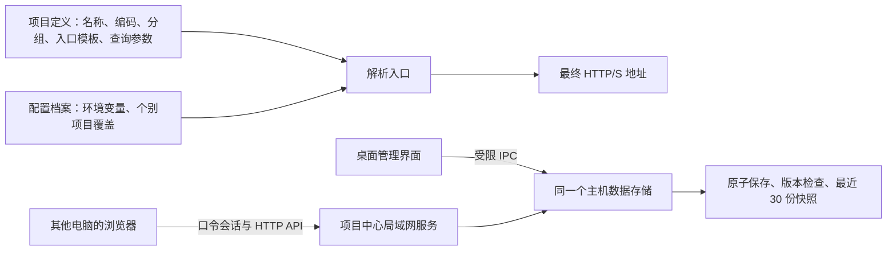

# 项目中心：项目入口、配置档案和局域网访问

项目中心将入口管理、环境配置、导入导出和备份恢复放在同一个工作流中。局域网仅开放这个模块，离线工具及其输入不会通过此服务提供。与项目中心平级的 [Nginx 配置](nginx.md)仅限桌面本机，不向局域网或独立项目服务开放文件读写与进程控制。

桌面项目中心与局域网页面共用外观：浅色为灰白与蓝色，深色为石墨灰与雾蓝；启用及检测通过保留绿色，错误使用柔红色，弹窗与输入区同步适配。网页入口首次按系统外观选择主题，登录后可手动切换；桌面按工作台的主题偏好切换。详见[界面设计说明](interface-design.md)。

## 数据逻辑



- **项目定义**只有一份：名称、唯一编码、分组、说明、HTTP(S) 地址模板、默认启用状态和查询参数。
- **配置档案**维护环境差异：如“开发”“测试”“生产”的变量，以及某个项目在该环境中的地址/启用覆盖。复制档案时保留其变量与覆盖；复制项目时创建独立定义。
- **当前档案是使用者自己的选择**。某人切换测试环境，不会把其他电脑正在使用的环境一起切走。
- **保存时检查版本**。多人同时编辑时，旧版本保存会被拒绝，弹窗里的编辑草稿仍保留。点击“刷新共享数据”，检查其他人的变化，再决定是否保存草稿。
- **导入先预览**，默认合并：同编码项目更新，同名档案合并变量和项目覆盖，文件外的内容保留；也可明确选择全部替换。导入和恢复前均自动备份，恢复会产生新版本。快照最多保留 30 份，支持自定义名称和恢复前内容预览。
- **批量操作只针对勾选项**，筛选外的勾选项也会明确提示。启停仅修改当前档案；切换档案清空选择。支持排序、紧凑卡片和列表，地址可按需展开。
- **编辑有草稿保护**，取消、关闭按钮、Esc 均在有修改时提示；退出应用/刷新页面也会提醒。空白参数行忽略，有值无名称会阻止保存。地址预览分解主机、路径和参数，能够查看各档案的解析结果。

示例：项目地址为 `http://{{host}}:{{webPort}}/console`；查询参数中添加 `lang=中文`。开发档案设置 `host=127.0.0.1`、`webPort=8080`；测试档案设置 `host=192.168.1.50`、`webPort=9090`。切换档案即可得到相应入口，查询参数自动编码并保留重复项。

## 环境档案对比

存在至少两个档案时，点击右上角“对比环境”，选择 2–4 个档案并排检查变量、项目启用状态、地址覆盖和最终解析入口。空字符串与未定义变量分别显示；缺失的模板变量会明确列出，包含 URL 和已启用查询参数的名称/值引用。默认只看差异，可取消筛选查看全部项目和变量。

对比只读取当前已保存数据，不修改或切换任何人的环境。桌面端和有权访问项目中心的只读/编辑访客均可查看。可导出 JSON 报告，报告包含所选档案的完整对比数据（不受“只看差异”视图筛选影响）；导出内容与项目变量一样为明文。

“修改项目定义”对所有档案生效；卡片上的“配置环境覆盖”只影响当前档案。若当前已有覆盖，修改基础地址不会替换覆盖。移除覆盖后重新使用基础定义。

启用/停用控制入口可用状态，不启动或停止操作系统服务。手动检测由主机发起 HEAD 请求，每次最多 20 个项目、并发 3 个、每个最多 4 秒、不跟随重定向、不保存检测结果。不自动轮询，也不代替业务功能验收。

## 最简单的局域网使用方式

1. 在 Windows、Linux amd64 或 Linux ARM64 主机安装本次 DevKit，打开左侧 **项目中心**。
2. 添加项目定义与配置档案，先确认最终地址预览正确。供其他电脑访问的服务地址应填写实际内网 IP/域名，不能使用指向访问者自身的 `localhost`、`127.0.0.1`。
3. 点击 **局域网共享**，选择“局域网（所有 IPv4 网卡）”，默认端口 `8765`。
4. 设置单独的访问口令（至少 8 位）。默认只读；需要协作管理时勾选“允许持有口令的访客编辑”。勾选“下次启动 DevKit 时自动开启共享”可保存启动偏好。
5. 点击“开启共享”，复制面板中主机真实网卡地址，例如 `http://192.168.1.50:8765/`。`0.0.0.0` 是监听设置，不是发给访客的访问地址。
6. 其他电脑连接同一局域网，用现代浏览器打开地址并输入口令。客户端不需要安装 DevKit、Node、Python 或 JDK。

共享服务使用 Electron 内置的 Node 能力，主机不需要另装 Node。关闭 DevKit 会停止服务；点击“停止共享”也会关闭下次自动共享。共享端口被占用时应换端口，应用不会自动结束占用端口的进程。

访问口令仅以加盐 scrypt 结果保存，会话使用 HttpOnly/SameSite Cookie。共享使用 HTTP，连接不加密，仅用于可信局域网。变量/项目地址会导出和共享，不应在这里存放登录密码或密钥。

## 防火墙与连接排查

主机和客户端之间需要允许 TCP `8765`（或实际端口）。程序不会自动修改系统防火墙。

Windows 管理员 PowerShell 可根据实际端口建立仅私有网络、本地子网可访问的规则：

```powershell
New-NetFirewallRule -DisplayName 'DevKit 项目中心' -Direction Inbound -Action Allow -Protocol TCP -LocalPort 8765 -Profile Private -RemoteAddress LocalSubnet
```

客户端可在 PowerShell 中检查连通性（替换主机 IP 和端口）：

```powershell
Test-NetConnection 192.168.1.50 -Port 8765
```

Linux/麒麟由管理员按其正在使用的防火墙配置允许实际内网网段访问该端口，无需安装或配置 Nginx。

如果无法访问，依次核对：共享面板是否显示运行中、复制的是否为主机实际内网 IP、是否选择了“仅本机”、网络/访客 Wi-Fi 是否隔离、主机防火墙及端口是否允许。若项目中心能打开而某个项目打不开，应检查该项目自己的 IP、端口和服务状态，两者是不同的网络服务。

## configs：配置位置、备份与整目录迁移

从 v1.6.0 起，项目中心使用**安装目录下的 `configs` 文件夹**。在项目中心右上角点击“配置文件”，可查看真实路径、复制路径或打开文件夹。

| 启动方式 | 默认配置位置 |
| --- | --- |
| Windows 安装版 | `devkit.exe` 同级的 `configs` |
| Linux / 麒麟 DEB | `/opt/devkit/configs` |
| 独立 Node ZIP | 解压根目录的 `configs`，与 `server` 同级 |
| 源码 `npm run desktop` | 仓库根目录的 `configs` |

目录包含 `projects.json`（项目、档案及最近 30 份快照）、`sharing.json`（共享选项及加盐口令哈希）、迁移记录和目录说明。配置不放进 ASAR、安装包或资源目录内。导出 JSON 仅含项目和档案，不含共享口令或历史快照。

首次启动发现新位置没有 `projects.json` 时，会自动迁入旧版用户数据目录的 `project-center`；独立 Node 服务会检查原先的 `data/project-center`。原文件不删除，已有 `configs/projects.json` 始终优先。损坏的旧文件会报错并保留，不会静默创建空项目替换。

整目录迁移：

1. **关闭来源与目标电脑的 DevKit / Node 服务**，避免复制到正在写入的数据。
2. 先备份目标电脑已有的 `configs`，再将来源 `configs` 整个复制到目标安装目录的相同位置。
3. 确保启动应用的普通用户对该目录有写入权限，再启动即可读取。启动锁属于运行状态，正常退出会清理；来自另一主机的锁可识别并恢复。
4. 项目地址中的固定 IP / 档案变量按业务需要调整。共享面板中的主机网卡 IP 会从新电脑重新获取；复制目录会同时复制共享口令、端口和自动共享偏好。

需要保留两边的项目时，使用“导出项目与档案”及“导入预览 → 合并到当前数据”。同编码项目采用导入定义；同名档案按变量名、关联项目合并，导入值优先。UI 提交前会列出新增、更新和移除数量；不手工拼接 `projects.json`。

Windows 新版升级和卸载会保留 `configs`。Linux 的 `configs` 为用户数据，不包含在 DEB 文件清单里，升级/卸载也不主动删除。彻底删除应用配置前请自行保留备份。

**目录权限：**推荐 Windows 安装到当前用户可写的位置。程序遇到不可写目录会显示完整路径和处理建议，不会悄悄切回用户目录。Linux 使用普通用户执行 `sudo dpkg -i` 安装时，安装脚本会为该用户准备 `/opt/devkit/configs`；已有非 root 所有者会保留。如果由纯 root/部署工具安装，或使用 root 拷贝过文件，可由管理员将配置目录交给实际启动者（替换用户名）：

```sh
sudo chown -R your-user /opt/devkit/configs
sudo chmod 700 /opt/devkit/configs
```

仅调整配置目录，不修改其他安装文件或系统库；以普通桌面用户启动应用。

数据保存使用进程锁、串行写入、临时文件同步后原子替换。数据损坏时保留原文件并显示错误，不自动用空数据覆盖。相同数据目录不能被两个主机进程同时打开。项目导出为明文，请根据数据内容保管导出文件。

## 无桌面常驻的部署方式

仓库还提供独立 Node 服务入口，同样只托管项目中心。适合部署到常开的 Windows/Linux/ARM64 服务器；**仅服务端需要 Node.js 24+**，浏览器客户端不需要。使用源码时先构建前端；使用 `DevKit_ProjectCenter_1.6.0_node24.zip` 时解压即可，不需要安装 npm 依赖或重新构建：

```powershell
# 仅源码部署需要先执行：npm run build
$env:HOST='0.0.0.0'
$env:PORT='8765'
$env:DEVKIT_PROJECT_PASSWORD='替换为独立访问口令'
$env:DEVKIT_PROJECT_EDIT='false'
node server/start.mjs
```

Linux 启动方式：

```sh
HOST=0.0.0.0 PORT=8765 \
DEVKIT_PROJECT_PASSWORD='替换为独立访问口令' \
DEVKIT_PROJECT_EDIT=false node server/start.mjs
```

首次启动必须提供口令，后续可复用数据目录内已保存的口令哈希而省略密码环境变量。默认只读，明确设置 `DEVKIT_PROJECT_EDIT=true` 才允许访客编辑。独立服务和桌面端使用相同数据目录时，只能启动其中一个；要迁移数据可通过项目中心导出/导入。

默认直接使用解压根目录的 `configs`，不受终端当前工作目录影响。如部署者明确需要其他位置，可自行设置绝对路径 `DEVKIT_PROJECT_DATA`；这属于显式覆盖，桌面安装版仍使用安装目录的 `configs`。

## 实现边界与验证

桌面端走受来源校验的最小 IPC；浏览器走独立 HTTP API，两者复用同一个模型校验和存储。局域网静态资源根据 `portal.html` 的构建依赖清单列白名单，不开放主工具箱入口、Worker、主机文件路径或桌面共享控制接口。

自动检查涵盖变量解析、重复参数、输入验证、并发保存、快照恢复/保留数量、损坏数据保护、进程锁、登录、读写权限、会话注销、来源检查、资源隔离及手动探活。真实 Electron / 浏览器集成验证覆盖项目创建、配置档案、环境覆盖、导入预览、冲突时草稿保留、Cookie 登录、只读页面和窄窗口。目标局域网的路由/防火墙及真实麒麟启动仍需在相应机器确认。
