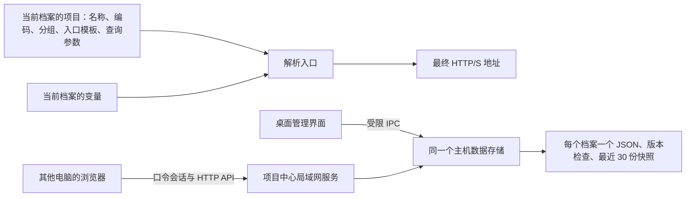

# 项目中心：项目入口、配置档案和局域网访问

项目中心将入口管理、独立方案配置、导入导出和备份恢复放在同一个工作流中。项目中心、HTTP 调试、Nginx、JAR及监控中心可独立开放共享；离线工具及其输入不会通过此服务提供，文件读写、检测及运行操作按服务分别授权。

桌面项目中心与局域网页面共用九套主题风格：默认、极简扁平、自然有机、编辑杂志、新野兽派、柔和界面、macOS 毛玻璃、现代渐变、复古怀旧，每套均支持浅色、深色与跟随系统。原有灰白/石墨灰与蓝色配色保留为默认主题；启用及检测通过保留绿色，错误使用柔红色，弹窗与输入区同步适配。网页顶部可分别选择风格和明暗模式，偏好保存在访问者当前浏览器；桌面在设置的“外观与工作台”中选择。详见[界面设计说明](interface-design.md)。

## 数据逻辑

桌面与共享网页的档案区、项目区分别在可用高度内滚动。增加档案不会拉长右侧项目区，增加项目也不会撑高档案区；内容超出时各自显示滚动条。窄屏改为上下排列，仍保留两个独立滚动区。可按 Tab 聚焦“配置档案”或“当前档案项目”面板，再使用方向键或 Page Up / Page Down 滚动。



- **每个档案完全独立**，分别保存自己的项目列表、变量与说明。项目编码只需在所属档案内唯一；不同档案允许相同编码与项目 ID，修改不会互相影响。
- **新建档案**从空项目、空变量开始；复制档案复制其项目与变量，保存后成为独立副本。项目卡片直接提供删除按钮，确认后只删除当前档案的项目；删除档案会移除该档案及其项目、变量和文件，至少保留一个档案。删除前均自动备份。
- **当前档案是使用者自己的选择**。某人切换测试环境，不会把其他电脑正在使用的环境一起切走。
- **保存时检查版本**。多人同时编辑时，旧版本保存会被拒绝，弹窗里的编辑草稿仍保留。点击“刷新共享数据”，检查其他人的变化，再决定是否保存草稿。
- **导入先预览**，默认合并：先匹配同名档案，再在档案内按项目编码和变量名合并，导入值优先，文件外的内容保留；也可明确选择全部替换。导入和恢复前均自动备份，恢复会产生新版本。快照最多保留 30 份，支持自定义名称和恢复前内容预览。
- **批量操作只针对勾选项**，筛选外的勾选项也会明确提示。选中项后显示批量栏，其中启用、停用、删除、检测、复制和清除选择均使用统一的14px图标与文字，垂直居中，窄屏整项换行。工具栏提供“删除所选”，确认框列出所选数量、名称及筛选外项目数。批量删除一次保存并自动备份，取消不修改数据；保存冲突保留确认框与选择，失败不会先移除项目。启停和删除仅修改当前档案；切换档案清空选择。支持排序、紧凑卡片和列表，地址可按需展开。
- **编辑有草稿保护**，取消、关闭按钮、Esc 均在有修改时提示；退出应用/刷新页面也会提醒。空白参数行忽略，有值无名称会阻止保存。地址预览分解主机、路径和参数，只预览当前档案的解析结果。

示例：项目地址为 `http://{{host}}:{{webPort}}/console`；查询参数中添加 `lang=中文`。分别在两个档案添加此项目（也可先复制档案），开发档案设置 `host=127.0.0.1`、`webPort=8080`；测试档案设置 `host=192.168.1.50`、`webPort=9090`。切换档案即可得到相应入口，查询参数自动编码并保留重复项。

## 对比方案

存在至少两个档案时，点击右上角“对比方案”，在“参与对比的档案”选择 2–4 个档案。按项目编码取并集对齐，明确标记“此方案无此项目”，并排展示项目名称、分组、说明、启停、地址模板、全部查询参数（含停用项）与最终解析入口，同时比较变量。内部项目 ID 与参数行 ID 不作为方案差异。空字符串与未定义变量分别显示；缺失的模板变量会明确列出，包含 URL 和已启用查询参数的名称/值引用。结果上方默认勾选“只看差异”，可取消勾选查看全部项目和变量。

对比只读取当前已保存数据，不修改或切换任何人的档案。桌面端和有权访问项目中心的只读/编辑访客均可查看。可导出 JSON 报告，报告包含所选档案的完整对比数据（不受“只看差异”视图筛选影响）；导出内容与项目变量一样为明文。

项目编辑、启停、复制和删除均只作用于当前档案，不再提供“仅覆盖当前档案”或基础定义的共享关系。

启用/停用控制入口可用状态，不启动或停止操作系统服务。网站探活仅由用户手动触发：

- 每个项目卡片/列表提供“探活”按钮，检测当前档案解析出的入口；停用或配置异常时按钮禁用并提示原因。
- 当前配置名称旁提供“全部探活”，检测该档案全部已启用项目，包含搜索、分组和状态筛选外的项目；已启用但配置异常的项目返回异常，停用项目计为跳过。原“检测所选入口”保留，处理全部勾选项，不再截断前 20 项。
- 按项更新结果并汇总进度、正常、异常及跳过数量。项目显示 HTTP 状态码或失败原因、耗时、检测时间及“主机检测”标识。检测期间禁止重复提交。
- 由主机发起 HEAD 请求，405/501 时回退 GET，最多跟随 5 次重定向，整个链路共用 5 秒超时；仅最终 2xx 判为正常。GET 收到响应头后取消响应体，不下载整个网页。认证页面返回 401/403 会显示异常，不能据此断言网站进程离线。
- 前端最多同时提交 3 个单项请求，覆盖完整档案；底层单次接口仍限制 20 项，主机跨访客及桌面请求统一限制并发 3 个。HTTPS 校验证书，仅支持不含用户名和密码的 HTTP(S) 地址。
- 结果仅在当前页面内存保留，切换档案、刷新共享数据或保存配置后清除；不写入配置或快照，不自动轮询。桌面和局域网页面沿用既有“检测项目入口”权限。结果代表主机到入口的连通情况，不代替业务功能验收。

## 最简单的局域网使用方式

1. 在 Windows、Linux amd64 或 Linux ARM64 主机安装本次 DevKit，打开左侧 **项目中心**。
2. 添加项目定义与配置档案，先确认最终地址预览正确。供其他电脑访问的服务地址应填写实际内网 IP/域名，不能使用指向访问者自身的 `localhost`、`127.0.0.1`。
3. 点击桌面顶部的 **局域网共享**（或项目中心的“共享设置”），选择“局域网（所有 IPv4 网卡）”，默认端口 `8765`。
4. 设置单独的访问口令（至少 8 位）。在服务卡片中开放“项目中心”，按需分别授权“编辑项目与档案”和“检测项目入口”；其余服务可独立选择。勾选“下次启动 DevKit 时自动开启共享”可保存启动偏好。
5. 点击“开启共享”，复制面板中主机真实网卡地址，例如 `http://192.168.1.50:8765/`。`0.0.0.0` 是监听设置，不是发给访客的访问地址。
6. 其他电脑连接同一局域网，用现代浏览器打开地址并输入口令。客户端不需要安装 DevKit、Node、Python 或 JDK。

共享服务使用 Electron 内置的 Node 能力，主机不需要另装 Node。关闭 DevKit 会停止服务；点击“停止共享”也会关闭下次自动共享。共享端口被占用时应换端口，应用不会自动结束占用端口的进程。

访问口令以加盐 scrypt 结果保存，会话使用 HttpOnly/SameSite Cookie。发布面板可启用 HTTPS、分配独立访客权限，并查看近期审计。复制项目资源链接后，访客登录并取得项目中心权限即可跳转到相应档案与卡片。见 [共享工作台](workspace-sharing.md)。

## 防火墙与连接排查

主机和客户端之间需要允许 TCP `8765`（或实际端口）。程序不会自动修改系统防火墙。

Windows 管理员 PowerShell 可根据实际端口建立仅私有网络、本地子网可访问的规则：

```powershell
New-NetFirewallRule -DisplayName 'DevKit 项目中心' -Direction Inbound -Action Allow -Protocol TCP -LocalPort 8765 -Profile Private -RemoteAddress LocalSubnet
```

客户端可在 PowerShell 中检查连通性（替换主机 IP 和端口）：

```powershell
Test-NetConnection 192.168.1.50 -Port 8765
```

Linux/麒麟由管理员按其正在使用的防火墙配置允许实际内网网段访问该端口，无需安装或配置 Nginx。

如果无法访问，依次核对：共享面板是否显示运行中、复制的是否为主机实际内网 IP、是否选择了“仅本机”、网络/访客 Wi-Fi 是否隔离、主机防火墙及端口是否允许。若项目中心能打开而某个项目打不开，应检查该项目自己的 IP、端口和服务状态，两者是不同的网络服务。

## configs：配置位置、备份与整目录迁移

从 v1.6.0 起，项目中心使用**安装目录下的 `configs` 文件夹**。在项目中心右上角点击“配置文件”，可查看真实路径、复制路径或打开文件夹。

| 启动方式 | 默认配置位置 |
| --- | --- |
| Windows 安装版 | `devkit.exe` 同级的 `configs` |
| Linux / 麒麟 DEB | `/opt/devkit/configs` |
| 独立 Node ZIP | 解压根目录的 `configs`，与 `server` 同级 |
| 源码 `npm run desktop` | 仓库根目录的 `configs` |

目录包含 `projects.json`（档案索引、版本及最近 30 份快照）、每个档案一个 `profile-<编码 ID>.json`（档案名称、说明、项目列表和变量）、`sharing.json`（共享选项及加盐口令哈希）、迁移记录和目录说明。档案 ID 使用十六进制编码作为文件名，避免 Windows 大小写文件名冲突；索引只引用 ID，不重复存储当前项目。配置不放进 ASAR、安装包或资源目录内。导出 JSON 仅含项目和档案，不含共享口令或历史快照。

首次启动发现新位置没有 `projects.json` 时，会自动迁入旧版用户数据目录的 `project-center`；独立 Node 服务会检查原先的 `data/project-center`。原文件不删除，已有 `configs/projects.json` 始终优先。损坏的旧文件会报错并保留，不会静默创建空项目替换。

旧版 schema v1 数据首次打开时自动展开：把原全局项目和各档案覆盖组合成每个档案的独立项目，保留变量、解析地址与启停状态；旧快照和 v1 导入文件也使用相同转换。原始文件另存为 `projects.v1.backup.json`，不会覆盖已有迁移备份。旧版无法判断项目最初属于哪个档案，因此迁移会保留各档案原先能看到的项目，之后可在各档案中分别删除不需要的项目。

整目录迁移：

1. **关闭来源与目标电脑的 DevKit / Node 服务**，避免复制到正在写入的数据。
2. 先备份目标电脑已有的 `configs`，再将来源 `configs` 整个复制到目标安装目录的相同位置。
3. 确保启动应用的普通用户对该目录有写入权限，再启动即可读取。启动锁属于运行状态，正常退出会清理；来自另一主机的锁可识别并恢复。
4. 项目地址中的固定 IP / 档案变量按业务需要调整。共享面板中的主机网卡 IP 会从新电脑重新获取；复制目录会同时复制共享口令、端口和自动共享偏好。

需要保留两边的项目时，使用“导出项目与档案”及“导入预览 → 合并到当前数据”。同名档案内按项目编码、变量名合并，导入值优先。UI 提交前会列出新增、更新和移除数量；不手工拼接配置文件。

Windows 新版升级和卸载会保留 `configs`。Linux 的 `configs` 为用户数据，不包含在 DEB 文件清单里，升级/卸载也不主动删除。彻底删除应用配置前请自行保留备份。

**目录权限：**推荐 Windows 安装到当前用户可写的位置。程序遇到不可写目录会显示完整路径和处理建议，不会悄悄切回用户目录。Linux 使用普通用户执行 `sudo dpkg -i` 安装时，安装脚本会为该用户准备 `/opt/devkit/configs`；已有非 root 所有者会保留。如果由纯 root/部署工具安装，或使用 root 拷贝过文件，可由管理员将配置目录交给实际启动者（替换用户名）：

```sh
sudo chown -R your-user /opt/devkit/configs
sudo chmod 700 /opt/devkit/configs
```

仅调整配置目录，不修改其他安装文件或系统库；以普通桌面用户启动应用。

数据保存使用进程锁、串行写入、临时文件同步后原子替换。跨档案保存先写入 `.projects-pending.json` 恢复日志，再更新独立文件和索引；中断后下次启动会继续完成保存，完成后删除日志。整目录复制应包含该隐藏日志。未修改的档案文件不会重写。数据损坏时保留原文件并显示错误，不自动用空数据覆盖。相同数据目录不能被两个主机进程同时打开。项目导出为明文，请根据数据内容保管导出文件。

## 无桌面常驻的部署方式

仓库还提供独立 Node 服务入口，可按选项开放共享工作台栏目。适合部署到常开的 Windows/Linux/ARM64 服务器；**仅服务端需要 Node.js 24+**，浏览器客户端不需要。使用源码时先构建前端；使用独立服务发行 ZIP 时解压即可，不需要安装 npm 依赖或重新构建：

```powershell
# 仅源码部署需要先执行：npm run build
$env:HOST='0.0.0.0'
$env:PORT='8765'
$env:DEVKIT_PROJECT_PASSWORD='替换为独立访问口令'
$env:DEVKIT_SHARE_PROJECTS='true'
$env:DEVKIT_PROJECT_EDIT='false'
node server/start.mjs
```

Linux 启动方式：

```sh
HOST=0.0.0.0 PORT=8765 \
DEVKIT_PROJECT_PASSWORD='替换为独立访问口令' \
DEVKIT_SHARE_PROJECTS=true DEVKIT_PROJECT_EDIT=false node server/start.mjs
```

首次至少显式开放一项服务。`DEVKIT_SHARE_PROJECTS=true` 开放项目中心，`DEVKIT_SHARE_LAN_HOSTS=true` 开放已保存的主机清单。Nginx、HTTP、JAR、监控和日志也可分别开放。服务开关、编辑和运行权限见 [共享工作台](workspace-sharing.md)。

首次启动必须提供口令，后续可复用数据目录内已保存的口令哈希而省略密码环境变量。项目编辑使用 `DEVKIT_PROJECT_EDIT=true`，入口检测使用 `DEVKIT_PROJECT_PROBE=true`，两者独立。后续启动复用已保存设置，环境变量逐项覆盖。独立服务和桌面端使用相同数据目录时，只能启动其中一个；要迁移数据可通过项目中心导出/导入。

默认直接使用解压根目录的 `configs`，不受终端当前工作目录影响。如部署者明确需要其他位置，可自行设置绝对路径 `DEVKIT_PROJECT_DATA`；这属于显式覆盖，桌面安装版仍使用安装目录的 `configs`。

## 待办清单

在“共享栏目 → 待办清单”新建或导入一份清单，直接在编辑区维护文本。分组名以冒号结尾，缩进可组织子分组和子任务。任务可以用 `☐`、`✔`、`✘` 三种符号，也可以粘贴 Markdown 复选框或 TaskPaper 风格任务。标签写在行尾，普通说明可单独写成文本行。

```text
发布:
  ☐ 核对安装说明 @today @high
  ☐ 验证局域网下载 @due(2026-12-01)
  ✔ 更新版本说明
```

- **工具栏**。新建、完成及添加子任务可直接操作。归档、取消、打开引用、源码在“更多操作”。扩展语法随光标显示常用项，其余可从“扩展语法”展开。窄屏用下拉框选择清单。
- **编辑**。将光标放在正文中。Ctrl/⌘+Enter 或 Alt+Enter 切换当前行的任务框，Alt+D 切换完成，Alt+C 切换取消，Alt+S 标记开始。任务末尾按 Enter 可继续添加同级任务。点击“保存”或按 Ctrl/⌘+S 将全文保存到主机。浏览器占用快捷键时，可用工具栏操作。
- **子任务**。将光标放在任务、子任务或续做点所在行，点击“添加子任务”，也可在下一层缩进手写 `☐ 子任务`。子任务可继续拆分，层级不设固定上限。每项子任务有自己的状态、标签和截止日期，可单独完成。大纲按层级缩进。续做点下的子任务仍属于该续做点所在的任务。
- **查找与归档**。展开“大纲”后可按文字、`@标签`、状态或今日与逾期筛选，点一行即可定位到原文。点击“归档”或按 Ctrl/⌘+Shift+A，将完成和取消的任务移到同文件的 `Archive:`，并保留备注、子任务和原分组标签。存在未完成子任务的父任务会留在原位置。
- **导入与导出**。在页面顶部点击“导入清单”，选择 `.todo`、Markdown、TaskPaper 或纯文本文件。支持 UTF-8 或带 BOM 的 UTF-16。导入会创建一份新清单。选中清单后点击“导出清单”，可将当前全文（含未保存的编辑和归档）保存为 UTF-8 `.todo` 文件。局域网页中，可编辑访客可以导入并发布新清单，只读访客可以下载已发布清单。
- **删除清单**。选中清单后，在正文标题旁点击“删除清单”并确认。删除会永久移除全文和归档，也会丢弃该清单的未保存编辑。局域网页中，仅有编辑权限的访客可删除已发布清单。
- **共享**。桌面清单默认仅本机可见，可逐份发布，再从顶部“局域网共享”开放“待办清单”。并发保存会校验清单版本，并保留本地草稿供导出。

### 待办扩展语法

扩展语法写在清单正文中。桌面端、局域网页和 `.todo` 导入导出共用同一份文本。

正文平时显示可点击的验收方框、续做点、链接和中文标签，大纲显示每项任务的验收进度。将光标移到一行即可编辑该行原始语法，也可以点工具栏“源码”查看全文。

有编辑权限时，编辑器上方的扩展操作栏提供八个按钮。选好任务或分组，填写内容后点击“写入清单”，再点击“保存”提交草稿。续做点用来交接或恢复工作，记录做到哪里、下次从哪接上。它随任务保存。用子任务跟踪仍需完成的具体工作。再次使用“续做点”可更新说明，并保留下方的子任务。要接着处理，可从大纲的“继续做”跳到续做点。

```text
:: 视图 待验收 @tag(验收) @state(open)
发布:
  :: 分组默认 @验收 @owner(小周)
  ✔ 打包 @id(build)
  ☐ 验证局域网下载 [[共享:发布材料]] @after(build) @验收
    ? [ ] ZIP 解压后目录完整
    :: 续做 已验证管理员下载，下次从只读账号开始
      ☐ 验证只读账号下载 @due(2026-12-02)
        ☐ 核对文件名
  ☐ 跟进麒麟安装 @wait(测试同事) @review(2026-12-04)
  ☐ 核对共享权限 @due(2026-12-07) @repeat(每周一)
```

| 语法 | 用法 |
| --- | --- |
| `? 条件` / `? [ ] 条件` / `? [x] 条件` | 在任务下缩进写验收条件。点击方框、按 `Alt+D` 或用“完成”切换勾选。大纲显示每项任务的进度，完成带有未勾选条件的任务时会提示确认。接受 `？` 和 `[✓]` 的写法。 |
| `:: 续做 说明` | 在任务下缩进写续做点，记录进度或恢复位置，也接受 `:: 接着` 和 `:: 续做点`。大纲的“继续做”可跳到原文。同一任务使用最后一条续做点。 |
| `:: 视图 名称 @tag(验收) @state(open)` | 在大纲生成筛选。多个条件需要同时满足。`@state` 支持 `open`、`done`、`cancelled`、`closed`、`today`、`waiting`、`follow-up`、`ready`、`blocked`。 |
| `[[共享:发布材料]]` / `[[工具:JSON 格式化]]` | 点击阅读样式的引用即可打开。编辑原文时可用“打开引用”、`Alt+O` 或 `Ctrl/⌘+单击`。共享支持按名称或 ID 定位，网页访客可打开自己有权访问的共享。工具引用可用名称或工具 ID，在桌面打开。 |
| `@wait(人员)` / `@review(YYYY-MM-DD)` | 大纲可筛选等待回访或到期回访。回访日到达后，清单底部提示待跟进数量。`@due` 继续表示截止日。 |
| `@id(build)` / `@after(build,sign)` | 同一清单内按 ID 关联前置任务。前置任务完成后，大纲会更新可开始状态，归档的完成记录也有效。点大纲中的前置任务可跳到原文。 |
| `@repeat(每周一)` | 用“完成”或 `Alt+D` 完成本期时生成下一期。支持 `每天`、`每周`、`每周一` 至 `每周日`、`每月`、`每月31日` 等。下一期的日期晚于当前到期日和完成日，月底不足指定日时取当月最后一天。周期规则移到下一期，下一期的验收条件重置。 |
| `:: 分组默认 @验收 @owner(小周)` | 在分组下缩进声明默认标签，也接受 `:: 默认`。用“新任务”、Enter 续写或给普通文本加任务框时自动填入。嵌套分组可覆盖同名标签，正文里已有的标签优先。 |

主机数据存放于 `configs/todo-lists.json`。首次打开会把原有项目各转为一份文本清单，保留任务、备注和原有发布状态。旧文件 `configs/project-todos.json` 留存完整数据，独立服务仍用 `DEVKIT_SHARE_PROJECT_TODOS=true` 开放、`DEVKIT_PROJECT_TODOS_EDIT=true` 授予编辑。

纯文本格式、快捷键和归档参考 Todo+，周期任务的历史保留和下一期 ID 处理参考 Obsidian Tasks。DevKit 复用自身的 CodeMirror 编辑器和共享存储。[Todo+](https://github.com/fabiospampinato/vscode-todo-plus) · [Obsidian Tasks 周期任务](https://github.com/obsidian-tasks-group/obsidian-tasks/blob/main/docs/Getting%20Started/Recurring%20Tasks.md)

## 实现边界与验证

桌面端走受来源校验的最小 IPC；浏览器走独立 HTTP API，两者复用同一个模型校验和存储。局域网静态资源根据 `portal.html` 的构建依赖清单列白名单，不开放主工具箱入口、通用工具 Worker、任意主机文件读取或桌面共享控制接口。HTTP 的 Schema 校验 Worker 随门户依赖开放。新增模块与权限见 [共享工作台](workspace-sharing.md)。

自动检查涵盖变量解析、重复参数、输入验证、并发保存、快照恢复/保留数量、损坏数据保护、进程锁、登录、读写权限、会话注销、来源检查、资源隔离及手动探活。真实 Electron / 浏览器集成验证覆盖项目创建、独立配置档案、项目删除、方案对比、导入预览、冲突时草稿保留、Cookie 登录、只读页面和窄窗口。目标局域网的路由/防火墙及真实麒麟启动仍需在相应机器确认。

当前档案存在缺失模板变量时，页面汇总名称并提供“补齐缺少的变量”；只向表单草稿补齐空项、定位变量值，不自动写入主机或改名已有变量。填写并保存后才生效。网页入口在访客浏览器打开，入口探测从主机发出，二者的localhost和网络可达性应分别理解。

选择对比档案后可查看已选名称和数量。导入步骤在写入失败时回到核对预览，保存成功后显示完成。
